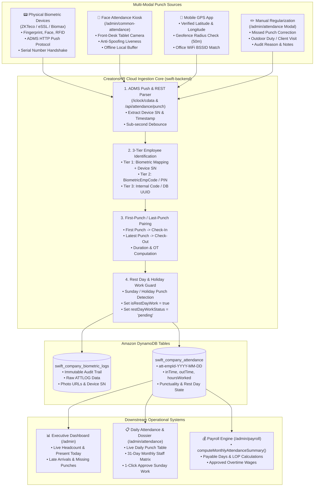
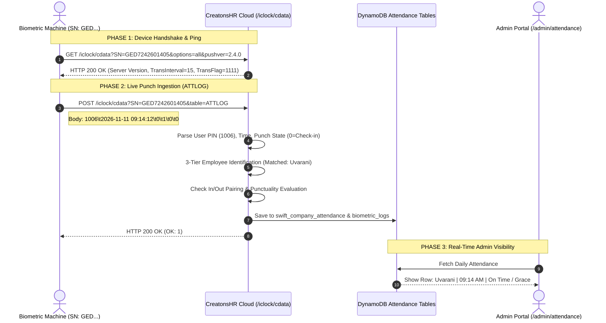
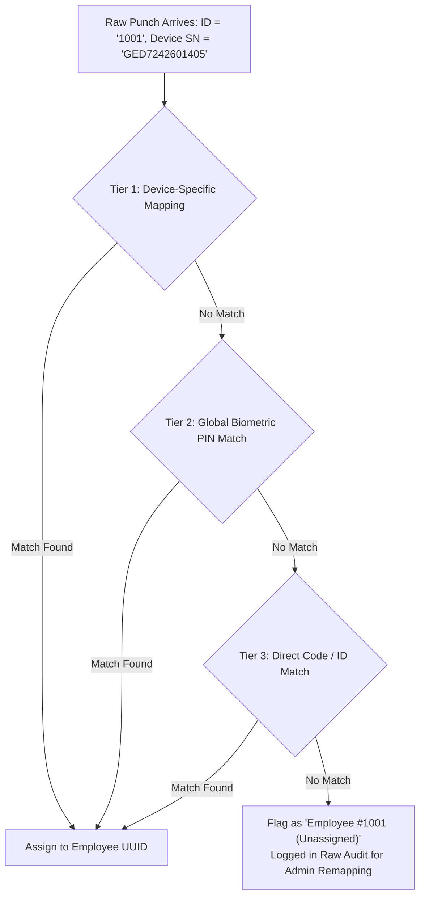
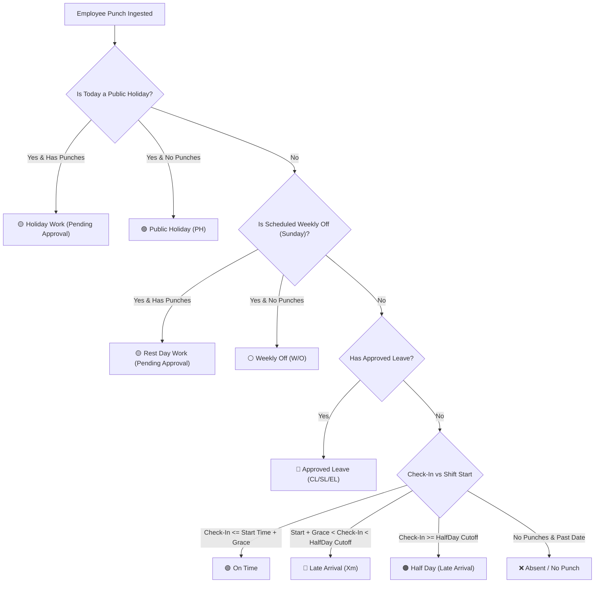
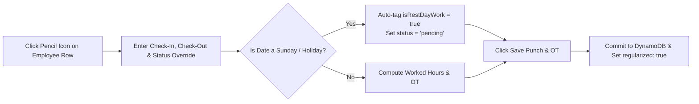

# CreatonsHR Attendance Engine — Architecture, Ingestion Pipeline & Operational Flow

> **Document Version:** 2.4  
> **System:** CreatonsHR Cloud Enterprise Suite  
> **Target Audience:** HR Directors, Operations Managers, Payroll Administrators, System Integrators, and Hardware Engineers  
> **Last Updated:** November 2026

---

## 1. Executive Summary

The **CreatonsHR Attendance Engine** is a high-throughput, multi-modal time & attendance processing system. It unifies punches from **physical biometric hardware (fingerprint, face, RFID)**, **touchless tablet kiosks**, **mobile GPS geofences**, and **administrative regularization overrides**.

### Core Capabilities
* **Multi-Protocol Hardware Ingestion:** Direct support for ZKTeco, eSSL, Biomax, and Realtime biometric machines via the ADMS `/iclock/cdata` HTTP/HTTPS push protocol.
* **Smart Punch Pairing & Deduplication:** Automatic first-punch / last-punch pairing with sub-second debounce filtering to eliminate accidental multiple swipes.
* **Dynamic Punctuality Evaluation:** Real-time punctuality tagging against scheduled shifts (On-Time, Grace Window, Late Arrival with exact minute delays, Half-Day, Absent, and Holiday).
* **Sunday & Public Holiday Rest Day Work Guard:** Punches recorded on Sundays or Public Holidays are automatically quarantined as **Pending Approval** until an administrator formally verifies the duty.
* **Audit Inspector & Photo Verification:** Deep-dive inspection of biometric face snapshots, device serial numbers, GPS map pins, and raw log timestamps.
* **Monthly Staff Attendance Matrix:** Interactive 31-day visual grid displaying daily attendance states (`P`, `HD`, `A`, `W/O`, `PH`, `CL/SL/EL`, `W/O (Pend)`) with export to Excel and CSV.
* **Direct Payroll Feeding:** Real-time synchronization of payable days, overtime hours, and Loss of Pay (LOP) deductions directly into the Payroll Engine.

---

## 2. Architecture & Ingestion Pipeline



---

## 3. Module Interconnection Matrix

The Attendance Engine acts as the operational heartbeat of CreatonsHR, interconnecting with **7 core modules**:

| Interconnected Module | Data Exchanged | Functional Operational Impact |
| :--- | :--- | :--- |
| **Biometric Hardware Terminals** | ADMS `/iclock/cdata` requests, device serial number (`GED7242601405`), raw `ATTLOG` lines | Streams real-time fingerprint and face punches into the cloud database with zero manual USB downloads. |
| **Employees Master** (`/admin/employees`) | `empCode`, `biometricPin`, `biometricMappings`, `branchId` | Maps raw hardware machine user IDs (e.g. `1001`, `1006`) to employee profiles and checks branch geofence permissions. |
| **Shift Roster & Scheduling** (`/admin/shift-roster`) | `shifts` (`start`, `end`, `graceMinutes`), `rosterWeekOffDays` | Evaluates daily punctuality against assigned shift hours; flags late arrivals and identifies unscheduled attendance. |
| **Leave Calendar & Holidays** (`/admin/leave-calendar`) | Public Holidays (`holidays[]`), declared off days | Distinguishes regular working days from official public holidays; triggers Holiday Work flow if punched. |
| **Requests & Approvals** (`/admin/requests`) | Approved leaves (`CL`, `SL`, `EL`), short permissions, regularizations | Replaces absent marks with "Approved Leave"; grants grace waivers for approved permissions. |
| **Payroll Engine** (`/admin/payroll`) | `daysPresent`, `daysHalf`, `absentDays`, `otHours`, `restDayApprovedHours` | Provides authoritative monthly attendance figures (`computeMonthlyAttendanceSummary`); drives LOP and OT payouts. |
| **HR Documentation** (`/admin/documentation-alt`) | Absenteeism counts, habitual late arrival frequencies | Automatically triggers formal attendance warning letters for employees exceeding late arrival thresholds. |

---

## 4. Hardware Push Protocol Specification (ADMS)

CreatonsHR natively implements the Push SDK / ADMS communication standard used by ZKTeco, eSSL, Biomax, and Realtime biometric machines.



### Supported Hardware Parameters
* **Target Server URL:** `http://api.swifthr.in/iclock/cdata` (or `http://localhost:5000/iclock/cdata`)
* **Target Port:** `80` (or `5000` for local dev / VPN)
* **Push Interval:** `15 seconds` (or real-time streaming)
* **Supported Punch Types:** Fingerprint (`FINGERPRINT`), Facial Scan (`FACE`), Palm Vein (`PALM`), RFID Smart Card (`CARD`), PIN Passcode (`PASSWORD`).

---

## 5. Employee Identification Engine (3-Tier Matcher)

A major source of attendance errors in legacy HR systems is employee ID mismatches between biometric hardware and cloud databases. CreatonsHR implements an intelligent **3-tier resolution engine**:



1. **Tier 1 (Device-Specific Mapping):** Checks if the employee profile has a mapped hardware record matching both `biometricEmpCode` and `deviceSn`. Supports multi-branch setups where an employee has ID `101` in Chennai and ID `504` in Bangalore.
2. **Tier 2 (Global Biometric PIN):** Matches `biometricPin` or `biometricEmpCode` regardless of hardware terminal serial number.
3. **Tier 3 (Direct Alphanumeric Code):** Matches internal `empCode` (e.g. `SW001`), database `id`, or payroll code.

---

## 6. Punctuality Evaluation & Attendance States

Daily punctuality is dynamically computed by comparing the employee's **Check-In Punch** against their **Scheduled Shift** and **Holiday Calendars**.

### Punctuality State Rules & Badges



### Detailed Evaluation Table
| Status Badge | Color Code | Condition / Trigger | Payroll Impact |
| :--- | :--- | :--- | :--- |
| **`On Time`** | 🟢 Green | Check-In $\le \text{Shift Start} + \text{Grace Minutes}$ | 1.0 Paid Day |
| **`Grace Window`** | 🟡 Yellow | Check-In within allowed grace threshold (e.g. 15 mins) | 1.0 Paid Day |
| **`Late (Xm)`** | 🔴 Red | Check-In exceeded grace window. Displays exact delay (e.g. `Late (24m)`) | 1.0 Paid Day (subject to 3-late-arrival company penalty rules) |
| **`Half Day`** | 🟠 Orange | Worked between 4.0h and 6.0h, or checked in past half-day cutoff | 0.5 Paid Day |
| **`Absent`** | ❌ Rose/Red | Scheduled working day with zero punches recorded | 0.0 Paid Day (triggers Loss of Pay) |
| **`Approved Leave`** | 🔵 Blue | Sanctioned leave in Requests module (`CL`, `SL`, `EL`) | 1.0 Paid Day (deducts from leave quota) |
| **`Weekly Off`** | ⚪ Slate | Scheduled weekly rest day with zero punches | Standard paid rest day |
| **`Public Holiday`** | 🟣 Purple | Calendar-declared holiday with zero punches | 1.0 Paid Holiday |
| **`Rest Day Work (Pending)`** | 🟡 Amber | Employee punched on Sunday/Rest Day; awaiting admin sign-off | **Zero credit** until approved |
| **`Rest Day Work (Approved · Xh)`** | 🟢 Emerald | Admin clicked "Approve Sunday Work" | Credited to Extra Paid Days & Overtime |
| **`Rest Day Work (Declined)`** | ⚪ Gray | Admin clicked "Decline Sunday Work" | Retained as rest day (zero credit) |

---

## 7. Sunday & Public Holiday Rest Day Work Workflow

Under corporate labor compliance, work conducted on non-working days (Sundays, Rest Days, Public Holidays) **must never automatically inflate payroll** without managerial verification.

```mermaid
stateDiagram-v2
    [*] --> Ingested: Punch logged on Sunday / Public Holiday
    Ingested --> PendingApproval: Auto-flagged by Attendance Engine
    note right of PendingApproval: Badge: Yellow\n"Rest Day Work (Pending Approval)"\nor "Holiday Work (Pending Approval)"
    
    PendingApproval --> Approved: Admin clicks "Approve Sunday/Holiday Work"
    note right of Approved: Badge: Green\n"Rest Day Work (Approved · 8h)"\nHours locked into Payroll as Extra Day & OT
    
    PendingApproval --> Declined: Admin clicks "Decline Sunday/Holiday Work"
    note right of Declined: Badge: Gray\n"Rest Day Work (Declined)"\nPunch retained for audit; 0 payroll credit
    
    Approved --> PayrollSync: Synced to computeMonthlyAttendanceSummary()
    Declined --> PayrollIgnored: Excluded from payable days
```

### 1-Click Administrative Actions
1. Open `/admin/attendance` and navigate to the Sunday or Holiday date.
2. Locate employees displaying 🟡 **`Rest Day Work (Pending Approval)`**.
3. Under the **Quick... / Actions** dropdown:
   * **Approve Sunday Work:** Calls backend API `POST /api/attendance/approve-rest-day` with `action: "approve"`. Badge immediately turns 🟢 **`Rest Day Work (Approved · Xh)`**.
   * **Decline Sunday Work:** Calls backend API with `action: "reject"`. Badge turns ⚪ **`Rest Day Work (Declined)`**.
4. In the **Monthly Staff Matrix**, pending rest day work renders as **`W/O (Pend)`** and is excluded from paid days until approved.

---

## 8. Manual Attendance & Overtime Regularization

When an employee forgets to clock in, works on client duty, or experiences hardware issues, administrators can manually regularize attendance.

### Step-by-Step Regularization Flow


1. Open `/admin/attendance`, locate the employee, and click the **Pencil Icon** (or **Quick Mark $\rightarrow$ Edit Punch / Regularize**).
2. Enter arrival time (e.g. `09:00 AM`) and departure time (e.g. `06:00 PM`).
3. Select status (`Present`, `Half-Day`, `Late`, `Absent`, `Leave`).
4. Select regularization reason (`Biometric Missed`, `On Duty / Client Visit`, `Technical Glitch`, `Emergency`).
5. Click **Save Punch & OT**. The record receives an amber **`Regularized`** audit tag.

---

## 9. Monthly Staff Attendance Matrix & Consolidated Audit

Accessible via `/admin/attendance` $\rightarrow$ **Monthly Staff Matrix** or **Consolidated Report**.

### Matrix Indicators Defined
* **`P` (Green):** Full Day Present.
* **`HD` (Orange):** Half Day Present (0.5 paid day).
* **`A` (Red):** Unexcused Absent (triggers Loss of Pay).
* **`W/O` (Gray):** Weekly Off.
* **`W/O (Pend)` (Yellow):** Sunday punch awaiting manager approval (**zero credit**).
* **`PH` (Purple):** Public Holiday.
* **`CL` / `SL` / `EL` (Blue):** Approved Paid Leave types.

### Summary Metrics Computed
$$\text{Payable Days} = \text{Present Days} + (\text{Half Days} \times 0.5) + \text{Paid Leaves} + \text{Approved Extra Days}$$
$$\text{Productive Hours} = \sum_{\text{All Punched Days}} (\text{CheckOut Time} - \text{CheckIn Time})$$
$$\text{Overtime Hours} = \sum_{\text{Approved Days}} \max(0, \text{Hours Worked} - \text{Standard Shift Hours})$$

---

## 10. Database Schema & Storage Specifications

### 10.1 Table: `swift_company_attendance`
Primary key: `tenantId` (Partition Key), `id` (Sort Key: `att-<employeeId>-YYYY-MM-DD`).

```json
{
  "id": "att_0eaf9f9e-82b4-4bc1-9ed3-68b1f078e789_2026-11-11",
  "tenantId": "59a4962f-1ce2-40d6-b7a6-c283702062ae",
  "employeeId": "0eaf9f9e-82b4-4bc1-9ed3-68b1f078e789",
  "employeeName": "Uvarani",
  "empCode": "1006",
  "department": "Finance",
  "date": "2026-11-11",
  "status": "present",
  "checkIn": "09:14:12",
  "checkOut": "18:56:30",
  "clockIn": "09:14:12",
  "clockOut": "18:56:30",
  "hoursWorked": 9.7,
  "otHours": 1.7,
  "deviceSerial": "GED7242601405",
  "punchType": "FINGERPRINT",
  "source": "BIOMETRIC_TERMINAL",
  "isRestDayWork": false,
  "regularized": false,
  "updatedAt": "2026-11-11T13:26:30.000Z"
}
```

### 10.2 Table: `swift_company_biometric_logs`
Immutable punch audit trail containing raw payloads:

```json
{
  "id": "bio_1793418252000_nfuj4",
  "tenantId": "59a4962f-1ce2-40d6-b7a6-c283702062ae",
  "employeeId": "1006",
  "employeeDbId": "0eaf9f9e-82b4-4bc1-9ed3-68b1f078e789",
  "employeeName": "Uvarani",
  "deviceSerial": "GED7242601405",
  "punchType": "FINGERPRINT",
  "state": "CHECK_IN",
  "date": "2026-11-11",
  "time": "09:14:12",
  "timestamp": "2026-11-11T03:44:12.000Z",
  "rawData": "AGENT_PUNCH: 1006\t2026-11-11T03:44:12.000Z\tCHECK_IN"
}
```

---

## 11. Master Troubleshooting Directory

### Issue 1: Employee punched on biometric machine, but attendance row remains blank
* **Root Cause:** Employee ID mismatch. The numeric User ID enrolled on the machine (e.g. `1006`) does not match the employee's `biometricPin` or `empCode` in `/admin/employees`.
* **Fix:** Open `/admin/employees`, edit the employee profile, and set **Biometric PIN** to `1006`.

### Issue 2: Punch shows `Late (NaNm)` with broken minutes
* **Root Cause:** A dash (`"-"`) or non-numeric string was entered in shift timings, causing mathematical subtraction to yield `NaN`.
* **Fix:** The CreatonsHR punctuality parser now strips invalid characters. Ensure shifts have valid `HH:mm` format in `/admin/settings`.

### Issue 3: Employee worked on Sunday, but hours do not reflect in Payroll
* **Root Cause:** By design, Sunday punches are held in **Pending Approval** to prevent unverified salary inflation.
* **Fix:** Open `/admin/attendance`, navigate to that Sunday, click the **Quick...** dropdown on the employee's row, and click **Approve Sunday Work**.

### Issue 4: Device disconnected / punches not syncing
* **Root Cause:** Biometric hardware lost internet connection or the server IP/ADMS domain changed.
* **Fix:** Verify the machine screen network icon. Check the machine's **ADMS / Cloud Server Settings** and ensure the server address points to `api.swifthr.in` on port `80`. Buffered punches will push automatically once reconnected.

---

*CreatonsHR Documentation · Generated for Customer Public Distribution · November 2026*

