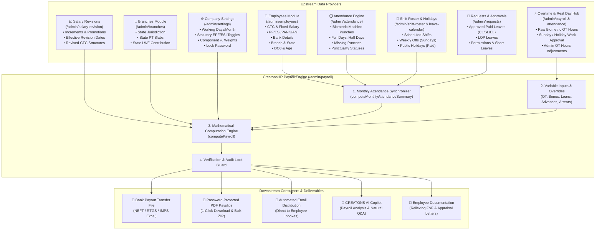
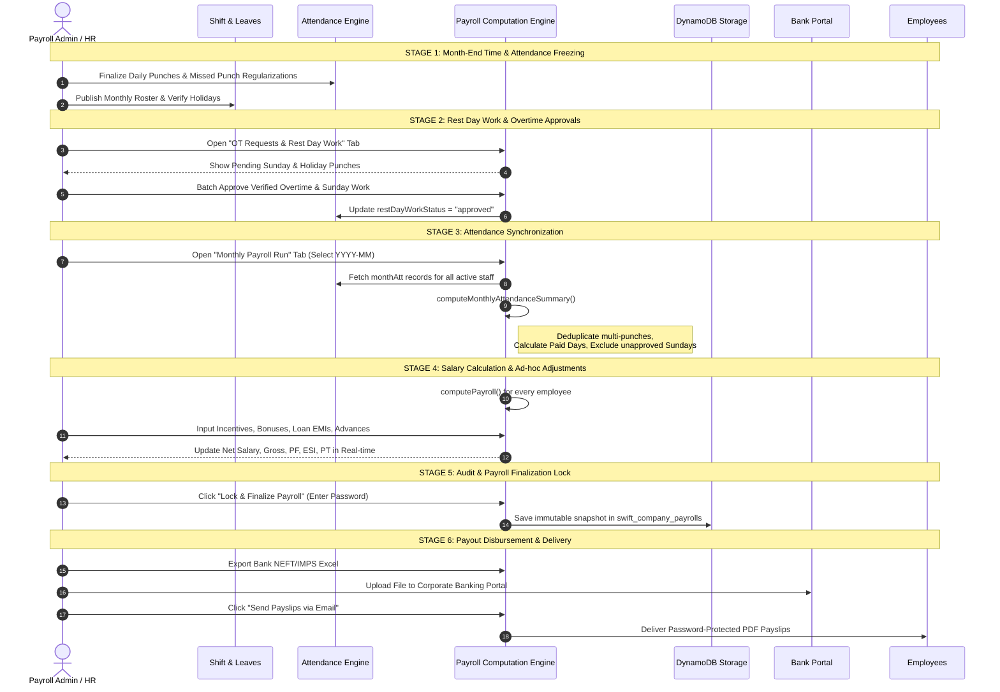

# CreatonsHR Payroll Engine — Architecture, Module Interconnections & Operational Flow

> **Document Version:** 2.4  
> **System:** CreatonsHR Cloud Enterprise Suite  
> **Target Audience:** Product Managers, HR Directors, Payroll Administrators, System Integrators, and Software Engineers  
> **Last Updated:** November 2026

---

## 1. Executive Summary

The **CreatonsHR Payroll Engine** is an automated, Indian statutory-compliant compensation and payroll processing system. It eliminates manual spreadsheet calculations by automatically pulling data from **Biometric Time & Attendance**, **Shift Rosters**, **Leave Approvals**, **Overtime Logs**, **Salary Revisions**, and **Branch Locations**.

### Core Capabilities
* **Dynamic Salary Structuring:** Supports custom component allocations (Basic, DA, HRA, Conveyance, Medical, Special Allowances, Custom Heads) with configurable percentage or flat amounts.
* **Automated Time & Attendance Sync:** Real-time proration based on actual punches, weekly offs, paid holidays, and approved leaves, automatically applying Loss of Pay (LOP) for unexcused absences.
* **Overtime & Rest Day Guard:** Overtime and Sunday/Public Holiday work hours are strictly quarantined in an approval queue before crediting to payable wages.
* **Full Indian Statutory Compliance:** Automated deductions for:
  * **EPF (Employees' Provident Fund Act 1952):** 12% employee contribution with ₹15,000 statutory ceiling option, employer 12% split into EPS (8.33%) and EPF (3.67%), plus EDLI (0.5%) and Admin charges (0.5%).
  * **ESIC (Employees' State Insurance Act 1948):** Evaluated against the ₹21,000 gross wage ceiling (0.75% employee, 3.25% employer).
  * **Professional Tax (PT):** State-specific slab evaluation based on the employee's branch location.
  * **TDS (Tax Deducted at Source):** Income Tax slab forecasting under New and Old tax regimes.
  * **Labour Welfare Fund (LWF):** State-wise employee and employer contribution rules.
* **Banking & Distribution:** 1-click export of NEFT/RTGS/IMPS salary transfer sheets for corporate banking (HDFC, ICICI, SBI, Axis), encrypted PDF payslip generation, and automated email delivery.
* **Audit Locking:** Cryptographic password lock preventing retro-active salary adjustments after disbursement.

---

## 2. Module Interconnection Architecture

The Payroll module does not operate in isolation. It acts as the central settlement hub connected to **8 distinct upstream and downstream modules**.



---

## 3. Detailed Interconnection Matrix

| Interconnected Module | Data Fields Ingested by Payroll | Purpose & Functional Impact |
| :--- | :--- | :--- |
| **Employees Master** (`/admin/employees`) | `fixedSalary`, `basic`, `salary`, `pfEligible`, `uan`, `esiEligible`, `esiNumber`, `pan`, `bankDetails`, `doj`, `dob`, `branchId`, `department`, `designation` | • Establishes benchmark monthly wage.<br>• Determines statutory PF/ESI eligibility.<br>• Feeds bank transfer file (Account, IFSC).<br>• Prorates joining month salary from `doj`.<br>• Resolves salary structure priority rules. |
| **Daily Attendance** (`/admin/attendance`) | Biometric punch logs, `status` (`present`, `half-day`, `leave`, `absent`), `checkIn`, `checkOut`, `hoursWorked` | • Aggregates total full days and half days.<br>• Deduplicates multiple punches on the same date.<br>• Computes absent days and triggers Loss of Pay (LOP) wage deductions. |
| **Shift Roster & Holidays** (`/admin/shift-roster`, `/admin/leave-calendar`) | `shifts`, `rosterWeekOffDays`, `company.holidays`, `workingDaysPerMonth` | • Establishes expected working days (default 26 or calendar days).<br>• Identifies paid weekly offs (Sundays) and official paid public holidays (PH). |
| **Requests & Approvals** (`/admin/requests`) | Approved Leaves (`type: "cl" \| "sl" \| "el"`), LOP Leaves, Permissions | • Sanctioned leaves are counted as Paid Days (no salary loss).<br>• Loss of Pay (LOP) leaves reduce payable days.<br>• Short leaves prevent half-day wage deductions. |
| **Overtime & Rest Day Hub** (`/admin/payroll` - Tab 3) | `otHours`, `isRestDayWork`, `restDayWorkStatus`, `restDayApprovedHours` | • Sunday and Holiday work hours stay in **Pending Approval** until admin sign-off.<br>• Approved hours multiply by `hourlyRate * otMultiplier` and get added to Gross Pay. |
| **Salary Revision** (`/admin/salary-revision`) | `newCtc`, `effectiveDate`, `revisionReason` | • Applies new CTC starting from effective month.<br>• Preserves historical payroll records for prior months without retro-active disruption. |
| **Branches Master** (`/admin/branches`) | `branch.state`, `branch.city`, `branch.isHead` | • Determines applicable state Professional Tax (PT) slab (e.g. Karnataka ₹200, Tamil Nadu, Maharashtra).<br>• Resolves state Labour Welfare Fund (LWF) employee and employer amounts. |
| **Company Settings** (`/admin/settings`) | `basicPct`, `hraPct`, `oaPct`, `pfRules`, `esiRules`, `ptSlabs`, `tdsRules`, `otMultiplier`, `payrollLockPassword` | • Governs percentage allocations for Basic, HRA, and allowances.<br>• Configures EPF ceiling (₹15,000 / ₹1,800 cap) and ESIC threshold (₹21,000).<br>• Controls payroll lock credentials. |

---

## 4. End-to-End Operational Lifecycle

The payroll execution follows a strict 6-stage operational cycle:



---

## 5. Mathematical Formulas & Calculation Engine

All calculations are encapsulated in [`swift-admin/src/lib/payroll.ts`](file:///d:/Programs/Swift-admin/swift-admin/src/lib/payroll.ts).

### 5.1 Attendance Proration Factor
Let:
* $W_D = \text{Standard Working Days in Month}$ (default 26 or calendar days 28–31)
* $D_P = \text{Full Days Present}$
* $D_{HD} = \text{Half Days Present}$
* $D_L = \text{Approved Paid Leaves}$
* $D_H = \text{Paid Public Holidays}$
* $D_{RD} = \text{Approved Rest Day / Sunday Work}$

$$\text{Payable Days } (D_{Paid}) = D_P + (D_{HD} \times 0.5) + D_L + D_{RD}$$
$$\text{Proration Factor } (P) = \frac{D_{Paid}}{W_D} \quad (\text{bounded between } 0 \text{ and } 1.0)$$
$$\text{Absent Days } = \max(0, W_D - D_{Paid})$$

---

### 5.2 Earnings Components (Gross Pay)

$$\text{Hourly Wage Rate } (R_{hourly}) = \frac{\text{Fixed Monthly Gross}}{W_D \times \text{Working Hours Per Day}}$$

| Component | Calculation Formula | Prorated? | Taxable? | In PF Base? | In ESI Base? |
| :--- | :--- | :---: | :---: | :---: | :---: |
| **Basic + DA** | $\text{Fixed Gross} \times \text{BasicPct} \times P$ | Yes | Yes | Yes | Yes |
| **HRA** | $\text{Fixed Gross} \times \text{HraPct} \times P$ | Yes | Partially | No | Yes |
| **Other Allowance (OA)** | $\text{Fixed Gross} \times \text{OaPct} \times P$ | Yes | Yes | No | Yes |
| **Conveyance (CA)** | $\text{Fixed Gross} \times \text{CaPct} \times P$ | Yes | Yes | No | Yes |
| **Leave Travel (LTA)** | $\text{Fixed Gross} \times \text{LtaPct} \times P$ | Yes | Partially | No | Yes |
| **Overtime (OT)** | $R_{hourly} \times \text{Approved OT Hours} \times \text{otMultiplier}$ | No | Yes | No | Yes |
| **Night Shift Pay** | $R_{hourly} \times \text{Night Hours} \times 1.15$ | No | Yes | No | Yes |
| **Incentive / Bonus** | Direct input / statutory bonus % | No | Yes | No | Yes |

$$\text{Total Gross Earnings} = \sum \text{Earned Components}$$

---

### 5.3 Statutory Deductions

#### A. Employees' Provident Fund (EPF Act 1952)
$$\text{PF Qualifying Wage } (W_{PF}) = \text{Earned (Basic + DA)}$$

* **If Basic + DA $\ge ₹15,000$ (Statutory Ceiling):**
  $$\text{Employee PF} = ₹15,000 \times 12\% = ₹1,800/\text{month}$$
* **If Basic + DA $< ₹15,000$:**
  $$\text{Employee PF} = W_{PF} \times 12\%$$
* **Employer Contribution (12%):**
  $$\text{EPS (Pension Fund)} = \min(W_{PF}, 15000) \times 8.33\% \quad (\text{Max } ₹1,250)$$
  $$\text{EPF (Employer)} = \text{Employer PF} - \text{EPS}$$
  $$\text{EDLI (Insurance)} = \min(W_{PF}, 15000) \times 0.5\%$$
  $$\text{Admin Charges} = \min(W_{PF}, 15000) \times 0.5\%$$

#### B. Employees' State Insurance (ESI Act 1948)
* **Eligibility Rule:** Evaluated on **Fixed Gross Salary**. If $\text{Fixed Gross} \le ₹21,000$, employee is covered.
$$\text{ESI Wage Base} = \text{Earned Gross (attendance prorated)}$$
$$\text{Employee ESI} = \text{ESI Wage Base} \times 0.75\%$$
$$\text{Employer ESI} = \text{ESI Wage Base} \times 3.25\%$$
* If $\text{Fixed Gross} > ₹21,000$, $\text{ESI} = ₹0$ (Exempt).

#### C. Professional Tax (PT)
Evaluated dynamically from branch state slabs.
* *Example (Karnataka / Tamil Nadu):*
  * Gross $\le ₹15,000$: ₹0
  * Gross $> ₹15,000$: ₹200 / month

#### D. Tax Deducted at Source (TDS)
$$\text{Annual Taxable Income} = (\text{Monthly Gross} \times 12) - \text{Standard Deduction } (₹75,000) - \text{Exemptions}$$
$$\text{Monthly TDS} = \frac{\text{Annual Income Tax Computed}}{12}$$

---

### 5.4 Net Take-Home Salary & Total CTC

$$\text{Total Deductions} = \text{Emp PF} + \text{Emp ESI} + \text{PT} + \text{TDS} + \text{LWF} + \text{Loan EMI} + \text{Advance Recovery} + \text{Fines}$$

$$\mathbf{Net\ Salary\ Payable\ In-Hand} = \mathbf{Gross\ Earnings} - \mathbf{Total\ Deductions}$$

$$\text{Employer Cost} = \text{Employer PF} + \text{Employer ESI} + \text{Employer LWF} + \text{Gratuity Accrual}$$
$$\mathbf{Total\ Monthly\ CTC} = \mathbf{Gross\ Earnings} + \mathbf{Employer\ Cost}$$

---

## 6. Real-World Calculation Walkthroughs

### Scenario 1: Standard Executive (PF Covered, Above ESI)
* **Employee:** Priya Sharma (Finance Lead)
* **Monthly Fixed Salary:** ₹30,000 | **Working Days:** 26
* **Attendance:** 26 Days Present (Full Month, Zero LOP, Zero OT)

| Wage Head | Monthly Fixed | Earned This Month | Notes |
| :--- | :--- | :--- | :--- |
| **Basic + DA (50%)** | ₹15,000 | ₹15,000 | Core PF Base |
| **HRA (25%)** | ₹7,500 | ₹7,500 | 50% of Basic |
| **Other Allowance (25%)** | ₹7,500 | ₹7,500 | Fully taxable |
| **Gross Earnings** | **₹30,000** | **₹30,000** | **Full month** |
| *Employee PF* | — | ₹1,800 | 12% of ₹15,000 ceiling |
| *Employee ESI* | — | ₹0 | Gross > ₹21,000 (Exempt) |
| *Professional Tax* | — | ₹200 | State slab |
| *TDS* | — | ₹500 | Income tax |
| **Total Deductions** | — | **₹2,500** | — |
| **Net Bank Transfer** | — | **₹27,500** | **Take-home pay** |

---

### Scenario 2: Associate with Overtime & Sunday Rest Day Work
* **Employee:** Sakthivel (Logistics Lead)
* **Fixed Salary:** ₹20,000 | **Working Days:** 26
* **Attendance:** 24 Regular Days Present, 1 Sunday Worked (8h Approved), 12 Hours Overtime Approved.
* **Payable Days:** $24 + 1 \text{ (Approved Sunday)} = 25 \text{ Days}$. Proration: $25 / 26 = 0.9615$.
* **Hourly Rate:** $₹20,000 / (26 \times 8) = ₹96.15/\text{hour}$.
* **OT Pay (2× Multiplier):** $12\text{h} \times (₹96.15 \times 2) = ₹2,308$.
* **Prorated Fixed Gross:** $₹20,000 \times (25/26) = ₹19,231$.
* **Total Gross:** $₹19,231 + ₹2,308\text{ (OT)} = ₹21,539$.
* **Deductions:**
  * Fixed salary is ₹20,000 ($\le ₹21,000$), so **ESI applies!**  
    $\text{ESI Base} = ₹19,231$. $\text{Emp ESI } (0.75\%) = ₹144$.
  * Earned Basic = $₹10,000 \times (25/26) = ₹9,615$.  
    $\text{Emp PF } (12\%) = ₹1,154$.
  * Professional Tax = ₹200.
  * Total Deductions = $₹1,154 + ₹144 + ₹200 = ₹1,498$.
* **Net Salary Payable:** $₹21,539 - ₹1,498 = \mathbf{₹20,041}$.

---

## 7. Data Models & Database Schemas

### 7.1 DynamoDB Table: `swift_company_payrolls`
Finalized monthly payroll registers are committed as immutable JSON snapshots:

```json
{
  "id": "pay_59a4962f_2026-10",
  "tenantId": "59a4962f-1ce2-40d6-b7a6-c283702062ae",
  "month": "2026-10",
  "status": "finalized",
  "isLocked": true,
  "lockedAt": "2026-11-02T10:30:00.000Z",
  "lockedBy": "admin@creatons.in",
  "totals": {
    "totalGross": 485000,
    "totalDeductions": 42100,
    "totalNet": 442900,
    "totalCtc": 528000,
    "employeeCount": 16
  },
  "records": [
    {
      "employeeId": "0eaf9f9e-82b4-4bc1-9ed3-68b1f078e789",
      "employeeName": "Uvarani",
      "empCode": "1006",
      "department": "Finance",
      "daysWorked": 26,
      "otHours": 0,
      "gross": 30000,
      "deductions": {
        "employeePF": 1800,
        "employeeESI": 0,
        "professionalTax": 200,
        "tds": 500
      },
      "net": 27500,
      "monthlyCTC": 32600
    }
  ]
}
```

---

## 8. Security, Permissions & Audit Lock

1. **Role-Based Access Control (RBAC):**
   * Only users with `super_admin` or `payroll_manager` permissions can access `/admin/payroll`.
   * Line Managers and HR Executives have read-only access or access restricted to OT approvals.
2. **Password-Protected Payroll Lock:**
   * Finalizing a payroll period requires entering the master `payrollLockPassword`.
   * Once locked:
     * Backdated attendance modifications cannot alter payable amounts.
     * Salary revision increments are queued for subsequent months.
     * Overtime requests for that period are frozen.
3. **Audit Trail:**
   * Every manual adjustment (Incentive, Bonus, Loan recovery, OT override) logs the admin user ID, timestamp, and justification comment.

---

*CreatonsHR Documentation · Generated for Customer Public Distribution · November 2026*

